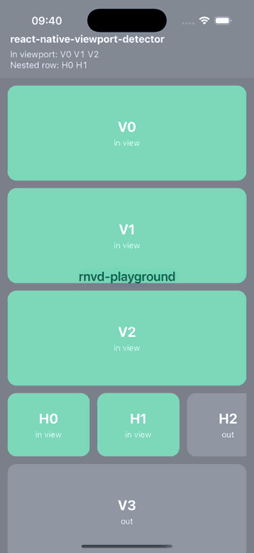
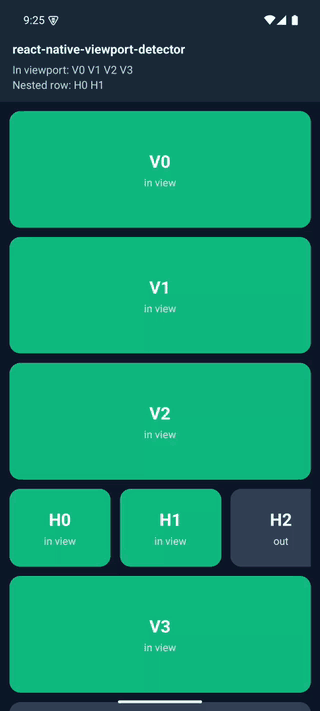

# react-native-viewport-detector

**Detect when a view enters the viewport in React Native — works in ScrollView, FlatList, FlashList and nested horizontal lists. Event-driven, zero idle cost, Expo Go ready.**

| iOS | Android |
| :-: | :-: |
|  |  |

- **Familiar API** — `useInView`, `<InView>`, `threshold`, `rootMargin`, `triggerOnce`: the same shape as the web's [`react-intersection-observer`](https://github.com/thebuilder/react-intersection-observer).
- **Accurate where others guess** — visibility is clipped by the scroll container *and* every ancestor container, so items in a horizontal carousel inside a vertical list, behind a header, or under a safe-area inset report the truth.
- **Event-driven** — no timers while nothing moves; while scrolling, one batched check per frame that measures only the views near the viewport, not every item.
- **Impression-ready** — `delay` (dwell time), automatic pause when the app goes to the background, `skip` for screen focus.
- **Expo Go, old & new architecture, iOS & Android.** No native code. Ships compiled JS + types and a Jest mock.

## Install

```bash
npm install react-native-viewport-detector
```

Requires React 18+ and React Native 0.72+. (Older apps: stay on `1.x`.)

## Quick start

Wrap the scroll view once, then ask any descendant whether it is visible:

```tsx
import { ScrollView, View } from 'react-native';
import { ViewportProvider, useInView } from 'react-native-viewport-detector';

export function Feed() {
  return (
    <ViewportProvider>
      <ScrollView>
        {posts.map(post => <Post key={post.id} post={post} />)}
      </ScrollView>
    </ViewportProvider>
  );
}

function Post({ post }) {
  const { ref, inView } = useInView({ threshold: 0.5 });
  return <View ref={ref}>{/* ... */}</View>;
}
```

`<ViewportProvider>` wraps exactly one scrollable child and adds its own `onScroll`/`onLayout` handlers next to yours — it never replaces them.

## Recipes

**Lazy-load an image** — start loading 300 px before it scrolls in:

```tsx
const { ref, inView } = useInView({ triggerOnce: true, rootMargin: { bottom: 300 } });
return <View ref={ref}>{inView ? <Image source={{ uri }} /> : <Placeholder />}</View>;
```

**Auto-play / pause video** — the threshold applies to the video's own view, not the whole row, and a video inside a nested carousel is clipped by both lists (`expo-video` shown; any player works):

```tsx
function FeedVideo({ source }) {
  const player = useVideoPlayer(source, p => (p.loop = true));
  const { ref, inView } = useInView({ threshold: 0.75 });
  useEffect(() => (inView ? player.play() : player.pause()), [inView, player]);
  return (
    <View ref={ref} collapsable={false}>
      <VideoView player={player} style={{ aspectRatio: 16 / 9 }} />
    </View>
  );
}
```

**Count an impression** — visible for at least one second, once:

```tsx
<InView threshold={0.5} delay={1000} triggerOnce onChange={seen => seen && track('impression', id)}>
  <AdCard />
</InView>
```

**Animate once when it appears:**

```tsx
<InView triggerOnce onChange={visible => visible && fadeIn.start()}>
  <Animated.View style={{ opacity }} />
</InView>
```

**Infinite list trigger:**

```tsx
<InView rootMargin={{ bottom: 600 }} onChange={near => near && loadMore()} />
```

**Pause while the screen is not focused (React Navigation):**

```tsx
const isFocused = useIsFocused();
const { ref, inView } = useInView({ skip: !isFocused });
```

**Nested carousel** — just nest providers; items are clipped by both lists:

```tsx
<ViewportProvider>
  <ScrollView>
    <ViewportProvider>
      <ScrollView horizontal>{cards}</ScrollView>
    </ViewportProvider>
  </ScrollView>
</ViewportProvider>
```

**FlatList / FlashList / Legend List** — wrap them like a ScrollView; if a list does not forward scroll props, wire it by hand:

```tsx
const root = useViewportRoot({ rootMargin: 100 });
return (
  <root.Provider>
    <FlashList ref={root.ref} {...root.scrollProps} data={data} renderItem={renderItem} />
  </root.Provider>
);
```

**Recycling lists (FlashList, Legend List)** — a recycled cell keeps its React state, so the hook's state belongs to the *cell*, not to the item it currently shows. `inView` is always right for what is on screen, but `triggerOnce` stops the cell for good: the next item recycled into it is never reported. For "once per item" (impressions, lazy-load), dedupe by item id instead of using `triggerOnce`:

```tsx
const seen = new Set<string>(); // module- or screen-level, not per cell

function Banner({ item }) {
  return (
    <InView threshold={0.5} delay={1000} onChange={visible => {
      if (visible && !seen.has(item.id)) {
        seen.add(item.id);
        track('impression', item.id);
      }
    }}>
      <BannerCard item={item} />
    </InView>
  );
}
```

(Alternatively give the tracked component `key={item.id}` so it remounts per item — simpler, but it gives up recycling for that subtree.)

## API

### `useInView(options?)`

Returns `{ ref, inView, entry }` (also `[ref, inView, entry]`). Attach `ref` to any host view.

| Option | Type | Default | Description |
| --- | --- | --- | --- |
| `threshold` | `number \| number[]` | `0` | Visible share of the view's area that counts as "in view". `onChange` fires whenever any threshold is crossed. |
| `rootMargin` | `number \| { top, right, bottom, left }` | `0` | Pixels added around the container for this view (negative shrinks). |
| `triggerOnce` | `boolean` | `false` | Stop observing after the first time the view is in view. |
| `delay` | `number` | `0` | Milliseconds the view must stay in view before `inView` becomes `true`. Leaving is reported immediately. |
| `skip` | `boolean` | `false` | Pause observing (keeps the last state). |
| `initialInView` | `boolean` | `false` | Value before the first measurement. |
| `onChange` | `(inView, entry) => void` | — | Called on every threshold crossing. |
| `root` | `null` | — | Pass `null` on a static screen to measure against the window without a provider warning. |

`entry` has `isIntersecting`, `intersectionRatio` (0–1, by area), `boundingClientRect`, `intersectionRect`, `rootBounds` and `time`.

### `<InView>`

A `View` that tracks itself. Takes the same options plus `ViewProps`. Children can be nodes or a render function `({ inView, entry }) => node`. With plain children and `onChange`, it never re-renders on visibility changes.

### `<ViewportProvider>`

| Prop | Default | Description |
| --- | --- | --- |
| `rootMargin` | `0` | Margin around this container. On the outermost container it extends past the screen edge (preloading); it carries into nested containers. |
| `pauseWhenInactive` | `true` | Report everything out of view while the app is in the background, re-check on return. |

### `useViewportRoot(options?)`

Returns `{ ref, scrollProps, Provider, invalidate, handle }` for lists that cannot be wrapped. Call `invalidate()` after a change the library cannot see (e.g. a parent's transform animation).

## When to use it — and when not

| You need | Use |
| --- | --- |
| Which **rows** of a FlatList/FlashList are visible | The list's own `onViewableItemsChanged` — it already has the layout. |
| Visibility of **any view** (a child inside a row, a carousel card, a section in a ScrollView) | This library. |
| Visibility inside **nested** scroll views | This library — the alternatives below don't clip by ancestors. |
| Whether a **part of a row** is visible (a video, a banner, a card in a nested carousel) by its own area | This library — `viewabilityConfig` measures whole items, on one axis. |
| Visibility while scrolling with a native-driver `Animated.event` | Works (checks every frame during touch/momentum) — full support is planned with the Reanimated engine. |

### Compared with alternatives

300 rows, scripted scroll at 1500 px/s for 5 s, same layout for every library, production build, on an Android 15 emulator and an iPhone 16 Pro simulator (iOS 18.1). "Wrong while scrolling" = share of truly visible rows reported wrong at each frame. Full method, all runs and raw output: [docs/BENCHMARKS.md](docs/BENCHMARKS.md).

| | Wrong while scrolling (Android / iOS) | Wrong after scrolling stops | Nested scroll views | Idle cost |
| --- | --- | --- | --- | --- |
| **react-native-viewport-detector 2.0** | **8–10% / 8%** | **0** | ✅ | none |
| react-native-intersection-observer 0.3 | 24–27% / 26% | 0 | ❌ (documented) | none |
| react-native-viewport-detector 1.0.8 | 26% / 33–34% | 0 | ✅ | timer per item |
| @futurejj/react-native-visibility-sensor 1.4 | 116–200% / 110–112% | 8–10 | window only | timer per item |

With the host idle, 2.0's scroll-time JS cost was indistinguishable from no tracking (16.7 ms frames).

## Testing your components

```ts
import { setupViewportMock, mockAllInView, mockInView, resetViewportMock } from 'react-native-viewport-detector/jest';

beforeEach(() => setupViewportMock());
afterEach(() => resetViewportMock());

it('tracks an impression', () => {
  render(<Feed />);
  act(() => mockInView('ad-1', 0.6)); // by testID
  expect(track).toHaveBeenCalledWith('impression', 'ad-1');
});
```

## Upgrading from 1.x

`ViewPortDetector` and `ViewPortDetectorProvider` still work in 2.0 exactly as in 1.0.8 (they log a one-time deprecation warning in development) and will be removed in 3.0. See [docs/MIGRATION.md](docs/MIGRATION.md).

## Example app

`example/` is an Expo app with a demo, a QA checklist, a 1,000-item benchmark, the library comparison and the 1.x example:

```bash
cd example && npm install && npx expo start
```

## License

ISC
