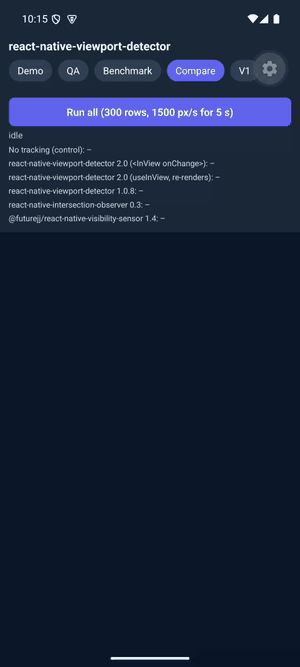

# Benchmarks

Measured on 2026-11-04 (engine after the final review) with the example app (`example/screens/Compare.tsx`, `example/bench/*`). Raw output: [benchmarks/2026-11-04-raw.txt](benchmarks/2026-11-04-raw.txt).

## Method

- 300 rows (44 px tall, 6 px apart) in one vertical `ScrollView`, wired the way each library documents.
- Each row only calls back into a shared set (no app re-render), so the numbers show the library's own cost.
- Every library counts a row as visible when any part of it is visible (`threshold` 0 or the library's equivalent).
- After mounting: 2 s settle, 2 s idle, then a scripted scroll with `scrollTo` at **1500 px/s for 5 s**, then 1 s settle.
- Ground truth comes from the layout and the offset native reports in `onScroll`.
- Metrics:
  - **Frame avg / p95** — JS-thread frame time from `requestAnimationFrame` during the scroll (16.7 ms = 60 fps).
  - **Dropped** — frames longer than 25 ms.
  - **Wrong while scrolling** — per frame, rows reported wrong ÷ rows truly visible, averaged. Values over 100% mean a library also reports many invisible rows as visible.
  - **Wrong after stop** — rows still reported wrong 1 s after scrolling stopped.
- Builds: Expo Go SDK 58, React Native 0.88, production bundle (`expo start --no-dev --minify`) on a Pixel 7 emulator (Android 15), Apple-silicon Mac. A run counts only if the offset native reported matches the scripted one. Emulators are noisier than phones; run it on your own device from the example app.

## Results



*Run E, recorded (6× speed).*

### Android 15 emulator, host idle (runs E and F)

| Library | Frame avg | p95 | Dropped | Wrong while scrolling | Wrong after stop |
| --- | --- | --- | --- | --- | --- |
| No tracking (control) | 16.7 ms | 17.8–18.4 ms | 0% | — | — |
| **viewport-detector 2.0 `<InView onChange>`** | 16.7–19.9 ms¹ | 17.3–39.7 ms¹ | 0–9.6%¹ | **7.9–10.2%** | **0** |
| viewport-detector 2.0 `useInView` | 16.7 ms | 17.3–18.5 ms | 0% | 7.9–8.6% | 0 |
| viewport-detector 1.0.8 | 16.7–16.9 ms | 19.8–21.0 ms | 0.3% | 26.3–26.5% | 0 |
| react-native-intersection-observer 0.3.1 | 16.7–17.0 ms | 17.2–20.2 ms | 0–0.3% | 23.5–26.8% | 0 |
| @futurejj/react-native-visibility-sensor 1.4.19 | 16.6–176.5 ms² | 20.4–422 ms² | 0.3–100%² | 116–200% | 9–10 |

¹ One hiccup in run F; `useInView`, which runs the same engine plus re-renders, measured 16.7 ms right after it. Run E: 16.7 ms / 17.3 ms / 0%.
² Run F, the last library in the sequence, degraded badly (idle frames 307 ms).

### Android 15 emulator, host under load (runs C and D, iOS simulator running too)

| Library | Frame avg | Dropped | Wrong while scrolling | Wrong after stop |
| --- | --- | --- | --- | --- |
| No tracking (control) | 19.5–20.6 ms | 18–20% | — | — |
| **viewport-detector 2.0 `<InView onChange>`** | 20.1–22.1 ms | 18–27% | **8.7–11.8%** | **0** |
| viewport-detector 2.0 `useInView` | 21.4–22.2 ms | 27–29% | 9.8–11.8% | 0–1 |
| viewport-detector 1.0.8 | 21.2–22.6 ms | 25–28% | 28.8–32.9% | 0–1 |
| react-native-intersection-observer 0.3.1 | 22.0–22.5 ms | 24–27% | 30.2–30.8% | 0 |
| @futurejj/react-native-visibility-sensor 1.4.19 | 67.5–69.3 ms | 59–69% | 203.8–208.1% | 9–11 |

### iOS

Not published for this version. On the iPhone 16 Pro simulator the scripted `scrollTo` did not keep up in 3 of 4 attempts (the offset native reported lagged far behind the one requested), which invalidates the ground truth. Run the Compare screen on an iPhone to measure iOS.

## Reading the numbers

- **Accuracy:** 2.0 reports about 3× fewer wrong rows while scrolling than the next best (8–12% vs 23–33%), because it re-checks on every frame that scrolled instead of on a 100 ms throttle or a polling timer. The remainder is a one-frame lag at the leading and trailing edges.
- **Cost:** with the host idle, 2.0, 1.0.8 and react-native-intersection-observer are indistinguishable from no tracking (16.7 ms frames). Under load all of them lose frames at a similar rate. Each 2.0 scroll frame measures the targets near the viewport (about 15–25 views here), not the whole list.
- **Robustness:** 2.0 takes the list's movement from the median of the measured views, so a recycled cell (FlashList) or a sticky header moving on its own cannot shift every other row.
- **Re-rendering is the app's cost:** if every row repaints when it changes visibility, a 1,000-row `ScrollView` spends most of its time in React commits regardless of the library. Use FlatList/FlashList for long lists.
- **Not measured here:** nested scroll views (react-native-intersection-observer does not support them; visibility-sensor only compares with the window) — see the QA screen in the example app.

## Reproduce

```bash
cd example && npm install
npx expo start --no-dev --minify
# open in Expo Go → "Compare" tab → "Run all"
```
